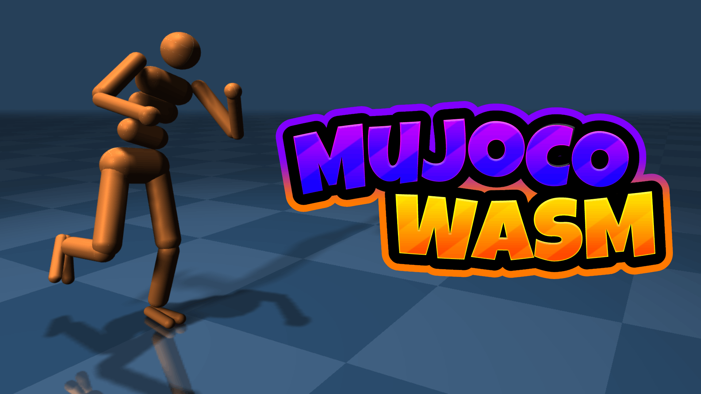

<p align="center">
  <a href="https://zalo.github.io/mujoco_wasm/"></a>
</p>
<p align="left">
  <a href="https://github.com/zalo/mujoco_wasm/deployments/activity_log?environment=github-pages">
      </a>
  <!--<a href="https://github.com/zalo/mujoco_wasm/deployments/activity_log?environment=Production">
      </a> -->
  <!--<a href="https://lgtm.com/projects/g/zalo/mujoco_wasm/context:javascript">
      </a> -->
  <a href="https://github.com/zalo/mujoco_wasm/commits/main">
      </a>
  <a href="https://github.com/zalo/mujoco_wasm/blob/main/LICENSE">
      </a>
</p>

## The Power of MuJoCo in your Browser.

Load and Run MuJoCo 3.12.0 Models using JavaScript and the official MuJoCo WebAssembly Bindings.

This project used to be a WASM compilation and set of javascript bindings for MuJoCo, but since Deepmind completed the official MuJoCo bindings, this project is now just a small demo suite in the `examples` folder.

### [See the Live Demo Here](https://zalo.github.io/mujoco_wasm/)

### [See a more Advanced Example Here](https://kzakka.com/robopianist/)

## Analytic locomotion controller (branch `analytic-controller`)

Browser demos of legged robots usually run a learned RL policy exported to ONNX. This branch drives the default
**Humanoid** scene with a hand-derived controller instead: no neural network, no optimisation at run time, about
50 µs of JavaScript per physics step. The humanoid that used to collapse on load now stands, walks where you steer it,
recovers from shoves, and performs a few scripted actions.

**How it works** (`src/controllers/`)
- **State:** COM position and velocity (`mj_jacSubtreeCom`), centroidal angular momentum (`mj_subtreeVel`), foot contact from the geometry of the foot capsules.
- **Contact-force feedforward:** for each supporting foot choose a ground wrench `W`, then `τ = qfrc_bias − qfrc_spring − Σ Jᵀ W` (`mj_jac` at the foot). This is exact gravity compensation that is consistent with the contacts.
- **Stand:** capture point (DCM) feedback → desired centre of pressure → wrench split between the two feet. Posture PD runs on the legs, arms and abdomen.
- **Walk:** a step clock, plus:
  - foot placement from the DCM-offset law of the linear inverted pendulum, using angular momentum about the stance foot (ALIP);
  - closed-form leg IK for the swing foot;
  - a stance-leg force through the COM applied with `Jᵀ`;
  - an ankle strategy inside the foot;
  - a velocity integrator, so `(vx, vy, yaw rate)` commands are tracked.
- **Transitions:**
  - weight shift before the first step;
  - stop only from a stable foot configuration;
  - automatic capture steps when pushed;
  - limp "fallen" state with auto-reset.
- **Hip motors:** the stock hip-abduction motor (40 N·m) equals the static single-support load, so the demo doubles it at run time (`model.actuator_gear`). Setting the GUI slider to 1 restores stock motors; walking then works only up to about 0.3 m/s.

**Controls:** W/S forward/back (Shift = fast), A/D turn, Q/E sidestep, X zero command, P random push. Drag the robot
with the mouse to shove it. The *Analytic Controller* GUI folder has behaviours (Stand/Walk, March, Squats, Sway,
Wave, Dance), command sliders, stand height, hip strength, follow camera, and markers. Marker colours: red = capture
point, green = commanded CoP, blue = next foothold.

**Tests** (headless Node, same code as the browser):
- `npm run test:controller` runs acceptance tests: standing, pushes, walking speed/strafe/turn tracking, scripted stop/start scenario, behaviours, stock motors, cost, other timestep.
- `npm run test:soak` sends random commands with stops for 120 s per seed. At the time of writing, 39/40 seeds survive with frequent stops and 24/24 with continuous stepping.
- `npm test` also runs `test_load.mjs`. With `@mujoco/mujoco` 3.17 (what `^3.12.0` currently resolves to), `flex.xml` and `hammock.xml` fail to load. That predates this branch.

## Build

Simply ensure `npm` is installed and run `npm install` to pull three.js and MuJoCo's Official WASM bindings.

To serve and run the index.html page while developing, use an HTTP Server.  I like to use [five-server](https://github.com/yandeu/five-server).

## JavaScript API

```javascript
import load_mujoco from "@mujoco/mujoco";

// Load the MuJoCo Module
const mujoco = await load_mujoco();

// Set up Emscripten's Virtual File System
mujoco.FS.mkdir('/working');
mujoco.FS.mount(mujoco.MEMFS, { root: '.' }, '/working');
mujoco.FS.writeFile("/working/humanoid.xml", await (await fetch("./assets/scenes/humanoid.xml")).text());

// Load model and create data
let model = mujoco.MjModel.mj_loadXML("/working/humanoid.xml");
let data  = new mujoco.MjData(model);

// Access model properties directly
let timestep = model.opt.timestep;
let nbody = model.nbody;

// Access data buffers (typed arrays)
let qpos = data.qpos;  // Joint positions
let qvel = data.qvel;  // Joint velocities
let ctrl = data.ctrl;  // Control inputs
let xpos = data.xpos;  // Body positions

// Step the simulation
mujoco.mj_step(model, data);

// Run forward kinematics
mujoco.mj_forward(model, data);

// Reset simulation
mujoco.mj_resetData(model, data);

// Apply forces (force, torque, point, body, qfrc_target)
mujoco.mj_applyFT(model, data, [fx, fy, fz], [tx, ty, tz], [px, py, pz], bodyId, data.qfrc_applied);

// Clean up
data.delete();
model.delete();
```
